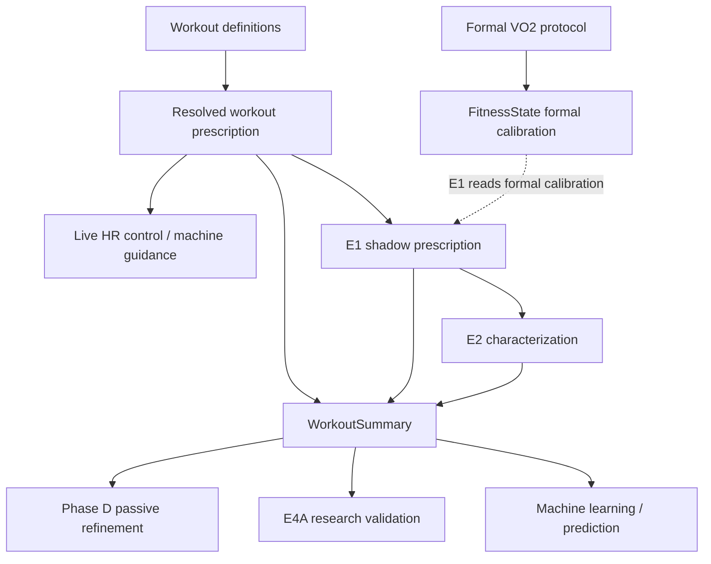

# Personalization architecture

Contributor-facing map of how Fitbaus personalization relates to workout
definitions, athlete state, and machine control.

> Workout definitions describe intent and phase semantics. Personalization
> evaluates athlete-specific advice and evidence. Runtime machine control
> remains a separate authority.

```text
workout template
    describes intended HR / phase semantics

resolved HR prescription ("legacy" HR path)
    live control authority for ordinary workouts

E1
    shadow athlete-relative watt advice (does not control resistance)

E2 / Phase D / E4A
    analyze or validate evidence

formal VO2 assessment
    can update formal athlete calibration in FitnessState
```

Do **not** assume E1 controls resistance. Live machine guidance currently
follows authoritative resolved HR targets.

---

## Architecture overview



Machine modeling and guidance are a **separate branch** from athlete
prescription shadow (E1/E2). They must not be conflated.

---

## Authority table

| Subsystem | Purpose | Durable? | Affects live control? | Authority |
| --- | --- | --- | --- | --- |
| **E1** | Formal-calibration → shadow watt band per phase | Yes (session / summary shadow fields, local) | **No** | Shadow prescription |
| **E2** | Characterize completed-workout response vs E1 | Yes (summary characterization, local; stripped from SISU) | **No** | Diagnostic |
| **E3** | Athlete-facing personalization status | Projection only | **No** (`activePersonalizationEnabled: false`) | Visibility |
| **E4A** | Scientific / prospective validation join | **No** (runtime diagnostics) | **No** | Research / diagnostic |
| **Phase D** | Passive fixed-HR descriptive workload trend | Yes (`FitnessState.passiveAerobicObservation`) | **No** | Persisted descriptive |
| **Formal VO2 assessment** | Protocol estimate + calibration promotion | Yes (summary + FitnessState) | **No** — formal calibration feeds E1 shadow advice, not current live control | Protocol assessment |
| **FitnessState** | Umbrella athlete metrics store | Yes (`fitness_state_v1`) | Not by itself | Mixed — see below |
| **Machine guidance** | Live resistance advice from HR targets | Session / audit | **Yes** (guidance path) | Production control |
| **Machine learning / prediction** | Equipment models / shadow predictions | Local machine stores | Learning feeds future guidance; prediction “shadow” ≠ E1 | Machine model |
| **Steady-state settled-workload** | Generic ordinary-workout settled evidence kernel | Design / contract (not normal product summary wire-up) | **No** | Shadow / design |
| **Threshold adapter / aggregate** | First named steady-state configuration | Same | **No** | Shadow / design |

---

## FitnessState

`FitnessState` is an **umbrella** athlete-state container. Residence in
FitnessState does **not** itself grant prescription authority.

### Formal assessment-derived state

- `vo2Max`
- `predictedMaxWatts`
- `hrWorkloadCalibration` (and related provenance / quality / algorithm)

This is the evidence **E1 currently consumes** (formal `hrWorkloadCalibration`
only). Passive metrics are not substitutes.

### Passive descriptive state

- `passiveAerobicObservation` (Phase D v2)
- historical `passiveAerobicTrend` (v1 compatibility)

These are multi-session descriptive observations (`eligibleForPrescription: false`).
They do not replace formal calibration, do not feed E1, and do not control the
machine.

---

## Personalization capability tables

Routing eligibility for product personalization lives in
`src/personalizationCapability.ts`. Two **orthogonal** dimensions:

### Phase intensity — `PERSONALIZATION_CAPABILITIES_V1`

Maps intensity → archetype (`steady_state` / `interval` / `recovery`), plus:

- `shadowPrescription` — may E1 consider this intensity?
- `completedWorkoutEvidence` — may settled-workload product evidence emit?

### Workout intent — `PERSONALIZATION_INTENT_CAPABILITIES_V1`

Owns E1 workout-intent routing. Currently enabled:

`aerobic_base`, `aerobic_volume`, `threshold`

Intent and phase intensity are independent. Example that is valid today:

```text
workoutIntent = aerobic_volume
phase intensity = aerobic_base
```

### What capabilities do **not** own

- scientific numeric thresholds (coverage, MAD, duration floors, …)
- HR zone definitions
- VO₂ protocol science
- Phase D admission science
- cross-intent evidence sharing (still unresolved)
- machine-control behavior

---

## Phase D independence

Phase D admission happens to allow `aerobic_base` and `threshold` phases — the
same intensity **strings** as E1 shadow enablement — but the **claims differ**:

| | E1 | Phase D |
| --- | --- | --- |
| Question | Can formal calibration produce a shadow watt candidate for this phase? | Can ordinary-workout evidence contribute to a passive descriptive trend? |
| Intent gate | Yes (capability table) | **No** |
| Explicit VO₂ selector gate | Yes | **No** (current non-admission of VO₂-style work is incidental via intensity/duration semantics) |

Phase D remains governed by its own scientific policy in `fitnessRefinement.ts`.
It must **not** reuse E1’s `shadowPrescription` flag.

---

## Steady-state / Threshold (design status)

- A generic **steady-state settled-workload** kernel exists.
- **Threshold** is the first named adapter (`completedWorkoutEvidence: true` for
  threshold intensity).
- This is contract / design / shadow work — **not** wired into normal
  `WorkoutSummary` persistence or product recommendation flow.
- Aerobic-base settled-workload evidence remains **disabled**.
- Aggregate policy still carries unresolved production thresholds where marked
  `null`.

Do not treat experimental watt figures as product recommendations.

---

## Workout finalization (ordinary path)

```text
start:
  freeze phase plan + E1 shadow evaluation

completion:
  generate WorkoutSummary
  optional WorkoutResponse + E2 (requires frozen plan)
  finalize execution provenance
  attempt summary persistence

if summary save succeeded:
  formal VO2 FitnessState promotion when applicable
  Phase D rebuild from history

independent later finalization:
  machine learning / prediction / dynamics ingestion
    (currently attempted even if summary persistence failed)
  lifecycle cleanup
```

`workoutSummary.ts` is intentionally an **orchestration boundary**. Scientific
logic stays in dedicated modules. If a frozen `phasePlan` is missing, summary
construction has a legacy fallback that may re-resolve `resolved_prescription`
from current templates; **WorkoutResponse / E2 fail closed** without the frozen
plan.

---

## Storage naming

IndexedDB database name `fitbaus_trainer_db` stores workout/session data
(summaries, HR samples, ordinary bike telemetry, and the SISU settings object
store). Product-owned localStorage keys use the `fitbaus_trainer_*` prefix.
`sisu_settings` remains the SISU integration store name.

Personalization fields on summaries are stored locally and **stripped** from
SISU sync payloads.

---

## Not currently active

These are **not** current product control:

- E1 candidates controlling resistance
- Settled-workload observations driving future workouts
- Threshold aggregate driving prescription
- E4A authorizing control
- E4B / E4C (do not exist as implemented product steps)
- Generalized cross-intent evidence sharing
- Phase D feeding E1 or machine control

---

## Glossary

| Term | Meaning |
| --- | --- |
| **E1** | Shadow watt prescription from formal HR/workload calibration; never live control |
| **E2** | Completed-workout characterization of E1 candidates / held-workload response |
| **E3** | Athlete-facing personalization visibility; active control remains off |
| **E4A** | Scientific validation assessment; research/diagnostic; not durable FitnessState |
| **Phase D** | Passive fixed-HR descriptive workload trend in FitnessState |
| **FitnessState** | Umbrella athlete metric store; formal vs passive metrics differ in authority |
| **candidate** | E1 shadow watt band (`candidatePower`) for evaluation — not an approved control target |
| **shadow** | Two families: **athlete prescription shadow** (E1/E2) vs **machine prediction shadow** |
| **formal assessment** | VO₂ protocol–derived FitnessState metrics E1 may consume |
| **passive refinement** | Phase D history rebuild producing descriptive observation only |
| **settled workload** | Ordinary-workout evidence kernel after load settling; design/shadow today |
| **legacy HR control** | Still-authoritative resolved HR prescription / control mode (not “dead code”) |
| **workout intent** | Workout-level purpose (`aerobic_volume`, `threshold`, …); E1 routing dimension |
| **phase intensity** | Phase-level intensity id (`aerobic_base`, `vo2_short`, …); separate from intent |
| **machine guidance** | Live equipment advice driven by HR targets |
| **machine prediction** | Equipment predictive models; not athlete E1 shadow |

### “Legacy” naming

Identifiers such as `legacyPrescription`, `legacy_hr_control`, and
`legacy-hr-target-resolver` use “legacy” for historical reasons. They often
still represent **current production authority** for live HR control. “Legacy”
does not necessarily mean deprecated.

### `assessmentBasedWorkloadForPhase`

Surfaces frozen E1/`candidatePower` watt advice for a phase. It is derived from
formal assessment calibration, **advisory / shadow only**, and is not machine
control authority or a validated FTP/threshold prescription.
